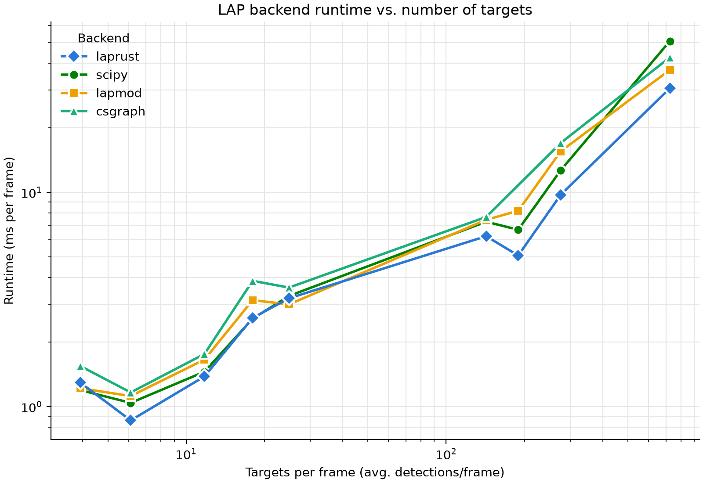
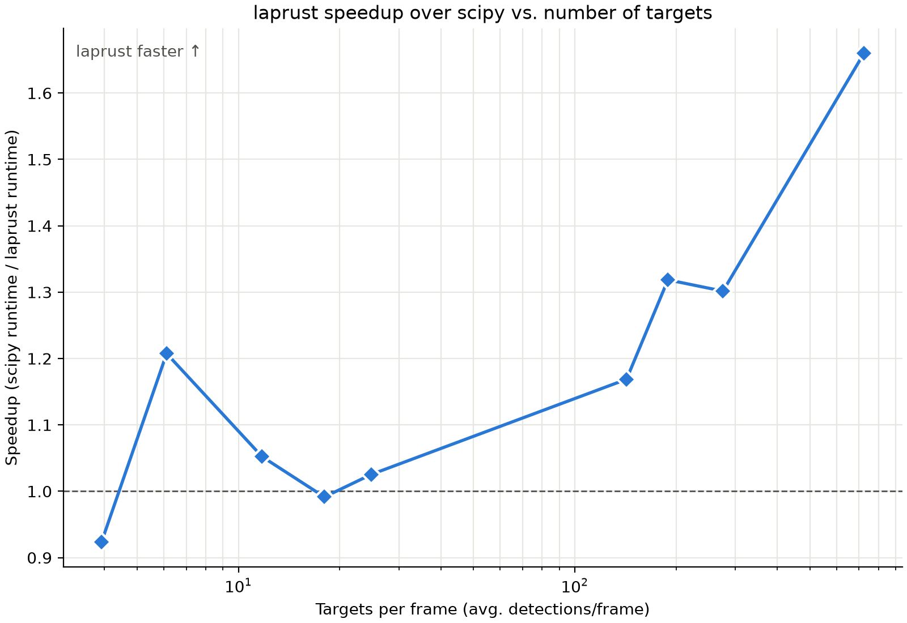

# Cell Tracking with the new `laprust`

Benchmarking the **Linear Assignment Problem (LAP) backend** of a standard Kalman tracker on
real cell-tracking data.

Cell and particle tracking in biology is commonly done frame by frame: a motion model (here a
Kalman filter) predicts where each tracked target should be, and a **linear assignment** matches
those predictions to the detections of the next frame. The assignment is solved with a LAP solver,
and several interchangeable solvers exist. This repository measures how much the *choice of solver*
matters for an otherwise identical pipeline — and in particular what the new Rust
solver `laprust` (the current `pylapy` default) buys you over the usual alternatives.

The tracker itself is [`byotrack`](https://github.com/raphaelreme/byotrack)'s `KalmanLinker`
([[1]](#references)). Only the LAP backend is swapped between runs — the detections, motion model, and association logic are
held fixed — so the tracks are **identical across backends** (checked at every run) and the
comparison is purely about speed.

## Backends compared

`byotrack` delegates the assignment to [`pylapy`](https://github.com/raphaelreme/pylapy), which
exposes several solvers. The assignment is solved with the same alternative cost, either as a sparse
problem (with `lapmod` / `csgraph`) or a dense problem (`laprust` / `scipy`). The four backends are detailed below:

| Backend   | Kind   | Solver                                              |
| --------- | ------ | --------------------------------------------------- |
| `laprust` | dense  | the new Rust solver from lapx (`pylapy`'s default)  |
| `scipy`   | dense  | `scipy.optimize.linear_sum_assignment`              |
| `lapmod`  | sparse | `lapmod` from [`lapx`](https://github.com/rathaROG/lapx) |
| `csgraph` | sparse | `scipy.sparse.csgraph.min_weight_full_bipartite_matching` |

All of these solve the assignment with a Jonker–Volgenant (JV) style algorithm; they differ in
implementation and in whether they exploit sparsity.

## Datasets

The backends are benchmarked on **9 sequences** of 100 frames each:

- The **8 2D datasets of the [Cell Tracking Challenge](http://celltrackingchallenge.net/) (CTC)**
  ([[3]](#references)): `BF-C2DL-HSC`, `BF-C2DL-MuSC`, `DIC-C2DH-HeLa`, `Fluo-C2DL-MSC`,
  `Fluo-N2DH-GOWT1`, `Fluo-N2DL-HeLa`, `PhC-C2DH-U373`, `PhC-C2DL-PSC`. For each dataset, we use the
  last sequence (2) and its last 100 frames. The provided segmentation masks in ERR_SEG (for the
  Cell Linking Benchmark) are loaded as detections, and then the tracking algorithms links them into
  tracks.
- An example of **neuron tracking in a behaving _Hydra vulgaris_** ([[2]](#references)): wavelet
  detection is run on a stretch of the `byotrack` Hydra example video (around a body contraction),
  and the resulting detections are linked.

These span roughly two orders of magnitude in crowding, from ~4 targets per frame
(`Fluo-C2DL-MSC`) to ~725 (Hydra).

## Method

For each dataset and each backend ([`benchmark.py`](src/cell_tracking_with_laprust/benchmark.py)):

1. The `KalmanLinker` is built once from the detections (motion model estimated from the data).
2. One **untimed warmup** run compiles numba kernels and warms caches.
3. **3 timed runs** are then measured with `time.perf_counter`, and the mean / min runtime
   **per frame** is reported.
4. The tracks are compared across backends and asserted identical (on their non-NaN entries).

Backends are selected by swapping `pylapy`'s dense/sparse implementation registries at runtime; the
original registries are restored afterwards. Results are stored in
[`results/benchmark.json`](results/benchmark.json).

> [!NOTE]
> All timings reported here were measured on a multi-core CPU laptop; absolute numbers will vary with
> hardware, but the relative trends between backends are what matters.

## Results





Mean runtime per frame (ms), sorted by crowding, with `laprust`'s speedup over `scipy`:

| Dataset           | targets/frame | `laprust` | `scipy` | `lapmod` | speedup vs `scipy` |
| ----------------- | ------------: | --------: | ------: | -------: | -----------------: |
| Fluo-C2DL-MSC     |           3.9 |      1.29 |    1.19 |     1.22 |              0.92× |
| PhC-C2DH-U373     |           6.1 |      0.86 |    1.04 |     1.12 |              1.21× |
| DIC-C2DH-HeLa     |          11.8 |      1.38 |    1.45 |     1.66 |              1.05× |
| BF-C2DL-MuSC      |          18.0 |      2.59 |    2.57 |     3.14 |              0.99× |
| Fluo-N2DH-GOWT1   |          24.9 |      3.20 |    3.28 |     3.00 |              1.03× |
| BF-C2DL-HSC       |         142.5 |      6.23 |    7.28 |     7.43 |              1.17× |
| PhC-C2DL-PSC      |         189.3 |      5.07 |    6.68 |     8.19 |              1.32× |
| Fluo-N2DL-HeLa    |         275.8 |      9.73 |   12.66 |    15.52 |              1.30× |
| Hydra (neurons)   |         724.9 |     30.56 |   50.75 |    37.23 |              1.66× |

### Takeaway

**`laprust` delivers a moderate-to-strong speedup over the alternatives, and the gain grows with
the number of targets.** On the crowded sequences it is clearly the fastest backend (≈1.3× over
`scipy` on the largest CTC datasets, **≈1.66× on Hydra** with ~725 targets/frame). On sparse
sequences (fewer than ~20 targets) all backends are within noise of each other and `laprust` is
around parity.

The reason is in how the per-frame cost splits:

- **Kalman prediction/update and track bookkeeping scale ~linearly** in the number of targets $n$.
- **The assignment scales super-linearly** (≈ $n^2$ or $n^3$ in the worst case for JV on these problems).

So as `n` grows, the assignment dominates total runtime, and the choice of LAP solver increasingly
decides how fast the whole tracker runs — which is precisely where `laprust`'s advantage shows up.
At low target counts the assignment is cheap and the constant-factor differences between solvers
wash out.

## Installation

The project is managed with [`uv`](https://docs.astral.sh/uv/):

```bash
uv sync
```

This requires `byotrack` (≥ 2.0.8) and `lapx` (≥ 1.3.0) providing the `laprust` / `lapmod` backend.

### Data

- **CTC** datasets are expected under `data/CTC/<dataset>/`. Download them from the [Cell Tracking Challenge](http://celltrackingchallenge.net/). We use the 8 experimental 2D datasets
- The **Hydra** example video is downloaded automatically by `byotrack` on first use.

## Usage

Run everything (all datasets, all backends) and store the timings:

```bash
bash run_all.sh
```

Or run individual benchmarks:

```bash
# Hydra neurons
uv run python -m cell_tracking_with_laprust.run_hydra

# One or more CTC datasets (defaults to sequence 02)
uv run python -m cell_tracking_with_laprust.run_ctc --datasets PhC-C2DL-PSC BF-C2DL-HSC
```

Then render the figures from `results/benchmark.json`:

```bash
uv run python -m cell_tracking_with_laprust.plot_benchmark   # runtime_vs_targets.png
uv run python -m cell_tracking_with_laprust.plot_speedup     # speedup_vs_targets.png
```


## Repository layout

```
src/cell_tracking_with_laprust/
  benchmark.py        # Core benchmarking: backend swapping, timing, track-equality check
  run_ctc.py          # Benchmark the CTC datasets
  run_hydra.py        # Benchmark the Hydra neuron-tracking example
  plot_benchmark.py   # Runtime-vs-targets figure
  plot_speedup.py     # laprust-vs-scipy speedup figure
results/              # benchmark.json and the generated figures
run_all.sh            # Runs every benchmark
```

## References

1. R. Reme, A. Newson, E. Angelini, J.-C. Olivo-Marin, T. Lagache. *Particle tracking in biological
   images with optical-flow enhanced Kalman filtering.* 2024 IEEE International Symposium on
   Biomedical Imaging (ISBI), 2024. — the `byotrack` Kalman tracker benchmarked here.
2. A. Hanson, R. Reme, N. Telerman, W. Yamamoto, J.-C. Olivo-Marin, T. Lagache, R. Yuste.
   *Automatic monitoring of neural activity with single-cell resolution in behaving Hydra.*
   Scientific Reports **14**(1):5083, 2024. — source of the Hydra neuron-tracking data.
3. M. Maška, V. Ulman, P. Delgado-Rodriguez, E. Gómez-de-Mariscal, T. Nečasová, F. A. Guerrero Peña,
   T. I. Ren, E. M. Meyerowitz, T. Scherr, K. Löffler, R. Mikut, T. Guo, Y. Wang, J. P. Allebach,
   R. Bao, N. M. Al-Shakarji, G. Rahmon, I. E. Toubal, K. Palaniappan, F. Lux, P. Matula,
   K. Sugawara, K. E. G. Magnusson, L. Aho, A. R. Cohen, A. Arbelle, T. Ben-Haim, T. R. Raviv,
   F. Isensee, P. F. Jäger, K. H. Maier-Hein, Y. Zhu, C. Ederra, A. Urbiola, E. Meijering, A. Cunha,
   A. Muñoz-Barrutia, M. Kozubek, C. Ortiz-de-Solórzano. *The Cell Tracking Challenge: 10 years of
   objective benchmarking.* Nature Methods, 2023. — the CTC datasets.

<details>
<summary>BibTeX</summary>

```bibtex
@inproceedings{reme2024particle,
  title={Particle tracking in biological images with optical-flow enhanced kalman filtering},
  author={Reme, Raphael and Newson, Alasdair and Angelini, Elsa and Olivo-Marin, Jean-Christophe and Lagache, Thibault},
  booktitle={2024 IEEE International Symposium on Biomedical Imaging (ISBI)},
  pages={1--5},
  year={2024},
  organization={IEEE}
}

@article{hanson2024automatic,
  title={Automatic monitoring of neural activity with single-cell resolution in behaving Hydra},
  author={Hanson, Alison and Reme, Raphael and Telerman, Noah and Yamamoto, Wataru and Olivo-Marin, Jean-Christophe and Lagache, Thibault and Yuste, Rafael},
  journal={Scientific Reports},
  volume={14},
  number={1},
  pages={5083},
  year={2024},
  publisher={Nature Publishing Group UK, London}
}

@article{maska2023cell,
  title={The Cell Tracking Challenge: 10 years of objective benchmarking},
  author={Ma{\v{s}}ka, Martin and Ulman, Vladim{\'\i}r and Delgado-Rodriguez, Pablo and G{\'o}mez-de-Mariscal, Estibaliz and Ne{\v{c}}asov{\'a}, Tereza and Guerrero Pe{\~n}a, Fidel A. and Ren, Tsang Ing and Meyerowitz, Elliot M. and Scherr, Tim and L{\"o}ffler, Katharina and Mikut, Ralf and Guo, Tianqi and Wang, Yin and Allebach, Jan P. and Bao, Rina and Al-Shakarji, Noor M. and Rahmon, Gani and Toubal, Imad Eddine and Palaniappan, Kannappan and Lux, Filip and Matula, Petr and Sugawara, Ko and Magnusson, Klas E. G. and Aho, Layton and Cohen, Andrew R. and Arbelle, Assaf and Ben-Haim, Tomer and Raviv, Tammy Riklin and Isensee, Fabian and J{\"a}ger, Paul F. and Maier-Hein, Klaus H. and Zhu, Yanming and Ederra, Cristina and Urbiola, Ainhoa and Meijering, Erik and Cunha, Alexandre and Mu{\~n}oz-Barrutia, Arrate and Kozubek, Michal and Ortiz-de-Sol{\'o}rzano, Carlos},
  journal={Nature Methods},
  year={2023},
  publisher={Nature Publishing Group}
}
```

</details>

## License

MIT — see [LICENSE](LICENSE).
